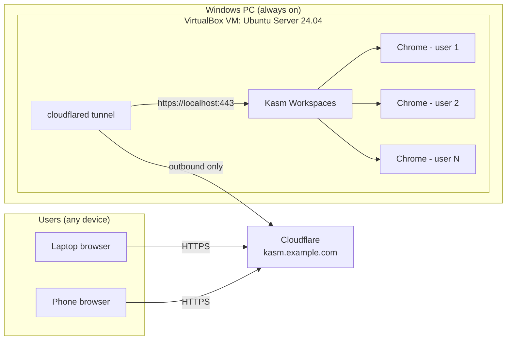

# Kasm Home Server

Turn an always-on Windows PC into a small **browser-based workspace server**. Friends or teammates open a web address, log in, and get their **own isolated Chrome** (or Linux desktop), streamed to any browser. No software to install on their side, and no ports opened on your router.

Built with **VirtualBox + Ubuntu Server 24.04 + Kasm Workspaces 1.19 + Cloudflare Tunnel**, and tested on a Windows 11 Pro host where Windows' own hypervisor could not be turned off. That made VirtualBox run in its slow "turtle" mode, so this repo also documents the workarounds that made it run reliably anyway.



## What you get

- One web address (for example `https://kasm.example.com`) protected by HTTPS
- A separate login and an isolated Chrome container for each user
- **Persistent profiles**: logins, bookmarks and cookies survive between sessions
- An admin panel to add and remove users, limit sessions and manage workspaces
- Automatic recovery after reboots and power cuts

## Important notes before you start

- **Each person uses their own accounts.** This shares *a computer*, not anyone's subscriptions. Every user signs in to AI tools, Google and other services with **their own** account inside their workspace. Sharing one paid account between several people breaks most services' terms.
- **Kasm licensing:** the free **Community Edition** is for personal and non-commercial use and allows **5 concurrent sessions**. Business use needs a paid Kasm license.
- **Privacy:** persistent profiles (saved logins) are stored on the server, so the server admin can technically access them. Tell your users.

## Requirements

| Item | Used in this build |
|---|---|
| Host PC | Windows 11 Pro, 32 GB RAM (the VM gets 12–17 GB and 8 vCPUs) |
| Hypervisor | VirtualBox 7.x |
| Guest OS | **Ubuntu Server 24.04 LTS**. Kasm 1.19 supports 22.04/24.04 only, **not 26.04** |
| Kasm | Workspaces 1.19.0 Community Edition |
| Domain | Any domain whose DNS is managed by Cloudflare (free plan) |
| Internet | About 10+ Mbps upload for a few simultaneous users |

## Setup overview

1. **Windows host:** never sleep, no surprise update restarts, and start the VM at boot. See [`windows/`](windows/) and [docs/setup-guide.md#1-windows-host](docs/setup-guide.md#1-windows-host)
2. **VirtualBox VM:** create it *without* the unattended installer, with NAT + port forwarding and a **virtio-net** network card
3. **Ubuntu Server 24.04** with OpenSSH
4. **Kasm:** install the [plugin retry wrapper](scripts/docker-plugin-retry-wrapper.sh) first, then install with `--skip-egress`
5. **Reboot safety:** the [`kasm-plugins.service`](systemd/kasm-plugins.service) unit
6. **Kasm config:** zone Proxy Port `0`, users, a Chrome workspace, persistent profiles, one session per user
7. **Cloudflare:** move DNS to Cloudflare and create a tunnel to `https://localhost:443` with TLS verification disabled and HTTP/2 enabled

Full walkthrough: **[docs/setup-guide.md](docs/setup-guide.md)**
Every error hit along the way, with its cause and fix: **[docs/troubleshooting.md](docs/troubleshooting.md)**

## Repository layout

```
.
├── README.md
├── docs/
│   ├── setup-guide.md          # step-by-step build
│   └── troubleshooting.md      # problems found and how they were solved
├── scripts/
│   ├── docker-plugin-retry-wrapper.sh   # retries slow Docker plugin starts
│   └── kasm-fix-plugins.sh              # re-enables Kasm plugins at boot
├── systemd/
│   ├── kasm-plugins.service             # runs kasm-fix-plugins.sh before Kasm
│   └── cloudflared-override.conf        # longer start timeout for cloudflared
└── windows/
    ├── server-power-settings.ps1        # never sleep / hibernate
    └── register-vm-autostart.ps1        # start the VM headless at boot
```

## Security checklist

- [ ] Change the passwords printed by the Kasm installer, and delete or rename `user@kasm.local`
- [ ] Never commit or share the Cloudflare tunnel token (`/etc/cloudflared/token`). Rotate it if it leaks.
- [ ] Don't add normal users to the **Administrators** group
- [ ] Back up `/mnt/kasm_profiles` regularly
- [ ] Optionally put **Cloudflare Access** (email one-time code) in front of the site

## License

No license has been chosen yet. Add one (for example MIT) if you want others to reuse the scripts.
